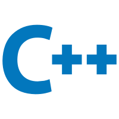

# Hi, here is daoge 👋

🌱 I'm an university student, major in `Computer Science and Technology` currently  
❤️ I like coding, and doing minecraft related things <code></code>  
📷 Beginner photography enthusiasts  
📻 I am a HAM, and my call sign is `BI4ASY`  
🌏 My time zone is `🕗GMT/UTC+8`  
🌴 I love summer  
⭐ [My Personality Type](https://www.16personalities.com/profiles/infp-t/m/9kv4unlvx): INFP-T  

#### 💬 CONTACT

✈️ Telegram: @daoge_cmd  
🕹️ Discord: @daoge_cmd  
📫 Email: lianyuanhao0@gmail.com  
🔑 You can find my PGP public key [here](https://github.com/smartcmd/smartcmd/PUBLIC_KEY.pgp)  

#### 💻 LANGUAGES

<code></code>
<code></code>
<code></code>
<code></code>
<code></code>
<code></code>

<!-- Github stats:

 -->

#### 🎮 GAMES

<code>&nbsp;Minecraft</code>
<code>&nbsp;Genshin Impact(China)</code>
<code>&nbsp;Battlefield V</code>

#### 📝 ORGANIZATIONS

<code>&nbsp;<a href="https://github.com/TokenFlux">TokenFlux</a></code>  
Founder of AllayMC: <code>&nbsp;<a href="https://github.com/AllayMC">AllayMC</a></code>  
Contributor of EndstoneMC: <code>&nbsp;<a href="https://github.com/EndstoneMC">Endstone</a></code>  
Contributor of Terra: <code>&nbsp;<a href="https://github.com/PolyhedralDev">Terra</a></code>

#### 📂 PROJECTS

**[TokenFlux/TokenRouter](https://github.com/TokenFlux/TokenRouter)**: An open source unified LLM gateway for Anthropic, OpenAI, Gemini, and other providers.  
**AllayMC/Allay**: The next-generation Minecraft: Bedrock Edition server software aims to be reliable, fast and feature-rich 🌟.  
**EndstoneMC/endstone**: High-level Plugin API for Bedrock Dedicated Servers (BDS), in both Python and C++.  
**PolyhedralDev/Terra**: Voxel world generation modding platform.  
